 

  

**One developer. Web, mobile, desktop. Shipping a little every day.**

## ✦ &nbsp;At a glance

<table>
<tr>
<td width="33%" valign="top" align="center">

### 🌐 Web
Next.js · React 
NestJS · Express · FastAPI · Fiber

</td>
<td width="33%" valign="top" align="center">

### 📱 Mobile
Flutter · React Native 
Expo · SwiftUI

</td>
<td width="33%" valign="top" align="center">

### 🖥️ Desktop
Tauri · SwiftUI (macOS) 
Go tooling

</td>
</tr>
</table>

## ✦ &nbsp;Tech stack

**Languages** 

**Frontend & Mobile** 

**Backend & Data** 

**Tools** 

## ✦ &nbsp;GitHub, in numbers

## ✦ &nbsp;Contribution snake

<picture>
  <source media="(prefers-color-scheme: dark)" srcset="https://raw.githubusercontent.com/Vince77361/Vince77361/output/github-snake-dark.svg"/>
  <source media="(prefers-color-scheme: light)" srcset="https://raw.githubusercontent.com/Vince77361/Vince77361/output/github-snake.svg"/>
  
</picture>

 

Consistency. — built with ♥ and a lot of commits

